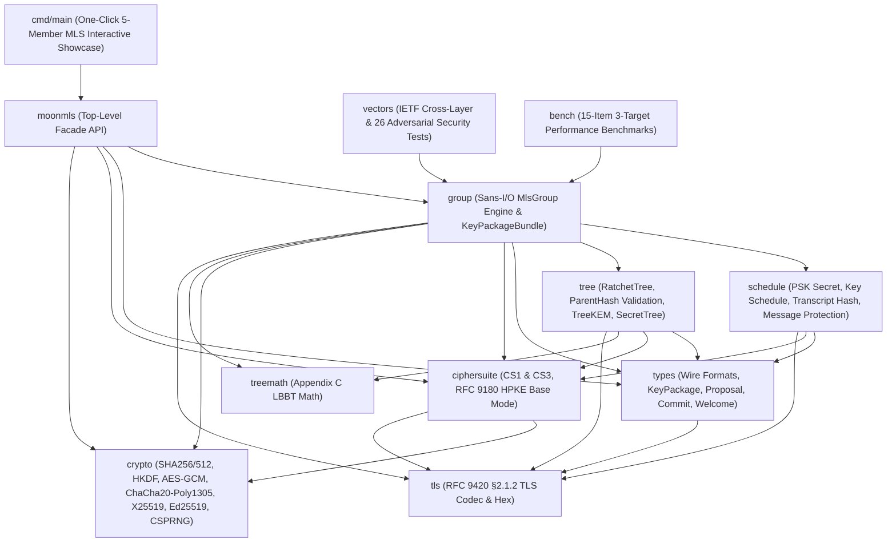

# MoonMLS — Pure MoonBit IETF RFC 9420 MLS & RFC 9180 HPKE Protocol Stack

**纯 MoonBit · 零 FFI · 零外部依赖 · Sans-I/O 端到端群组加密协议栈**
*Pure MoonBit, Zero-FFI, Zero-Dependency, Sans-I/O Implementation of IETF RFC 9420 Messaging Layer Security (MLS 1.0) & RFC 9180 HPKE*

> **2026 MoonBit 年度黑客松参赛作品** · 完整覆盖 RFC 9420 群组安全协议全栈，通过 IETF `mls-implementations` 全套官方测试向量逐字节校验与 26 项对抗安全测试，一套代码无修改原生运行于 `wasm-gc` / `js` / `native` 三端（`-d` 零警告）。

---

## 核心特性 / Highlights

- **双完整密码套件（Dual RFC 9420 CipherSuites）**：
  - **CS1 (`0x0001`)**：`MLS_128_DHKEMX25519_AES128GCM_SHA256_Ed25519`
  - **CS3 (`0x0003`)**：`MLS_128_DHKEMX25519_CHACHA20POLY1305_SHA256_Ed25519`
- **100% 纯 MoonBit · 零 FFI · 零外部依赖**：
  - 从底层有限域 $\mathbb{F}_{2^{255}-19}$ 算术、X25519（含低阶点拒绝）、Ed25519（RFC 8032 严格规范性校验防延展性）、SHA-256 / SHA-512、HMAC / HKDF、AES-128-GCM、ChaCha20-Poly1305、RFC 9180 HPKE Base Mode，到上层 Left-Balanced Binary Tree、Ratchet Tree、TreeKEM、Secret Tree、Epoch Key Schedule 与 `MlsGroup` 状态机，全部以纯 MoonBit 实现。
- **严格 Sans-I/O 与强原子性（Atomic State Machine）**：
  - 协议内核零网络 I/O、零文件 I/O、零全局可变状态，通过前向安全确定性 CSPRNG（`DeterministicRng`）注入熵源。
  - 所有消息解密、Commit 推进与 Welcome 验证均先完成全部密码学验证，再原子切换状态；任何篡改、重放或越权攻击保证**零状态污染**。
- **端到端安全属性实证**：
  - **前向安全（Forward Secrecy, FS）**：SecretTree 每代密钥消费即毁；Epoch 切换立即销毁旧代密钥表，跨 Epoch 密文严格拦截。
  - **事后安全（Post-Compromise Security, PCS）**：成员通过 `Update` + `Commit` 触发 TreeKEM 全路径密钥更新，彻底革新 `tree_hash`、`epoch_authenticator` 与 `MLS-Exporter`。
  - **动态成员管理与乱序容错**：支持 `Add` / `Update` / `Remove`、`Welcome` 加群、空白叶子复用与 `unmerged_leaves` 处理、SecretTree 滑动乱序窗口与同代重放拦截。
- **三端一码通行，`-d` 零警告**：全仓测试、基准测试与 5 人群组 CLI 演示在 `wasm-gc`、`js`、`native` 三大后端全部 100% 通过且零编译器警告。

---

## 模块架构 / Architecture

MoonMLS 采用严格无环分层架构（DAG），底层密码原语与协议状态机彻底解耦：



| 包名 / Package | 职责摘要 |
|---|---|
| `tls` | RFC 9420 §2.1.2 严格 TLS Presentation Language 编解码器（最小 Varint 检查、尾部数据拒绝）与 Hex/Bytes 工具 |
| `treemath` | RFC 9420 Appendix C 左平衡二叉树（LBBT）数学运算：`direct_path`、`copath`、`common_ancestor` 等 |
| `crypto` | 零 FFI 密码学原语库：SHA-256/512、HMAC/HKDF、AES-128-GCM、ChaCha20-Poly1305、X25519、Ed25519、ChaCha20 CSPRNG |
| `ciphersuite` | CS1 / CS3 密码套件封装、MLS `ExpandWithLabel` / `SignWithLabel` / `RefHash` 与 RFC 9180 HPKE Base Mode |
| `types` | RFC 9420 全套协议数据结构与二进制帧编解码（17 类 wire struct） |
| `tree` | Ratchet Tree 维护、Tree Hash & Parent Hash 链验证、TreeKEM 路径加解密、Secret Tree 与 Replay Window |
| `schedule` | PSK Secret、Epoch Key Schedule、Transcript Hash、Confirmation/Membership Tag 与 Public/PrivateMessage 保护 |
| `group` | 完整 Sans-I/O `MlsGroup` 状态机：`KeyPackageBundle`、`create`、`from_welcome`、`propose_*`、`commit`、`process_message` |
| `moonmls` (root) | 统一门面 API，开箱即用的高级类型别名与入口函数 |
| `vectors` | 跨层 IETF 集成校验与 26 项对抗安全测试套件（`SEC-01` ~ `SEC-26`） |
| `bench` | 15 项密码原语、协议层与 5 人群组端到端性能基准 |
| `cmd/main` | 一键 5 人群组全生命周期 CLI 演示（含 FS、PCS、动态踢人与 CS3 双套件自检） |

---

## IETF `mls-implementations` 官方测试向量逐字节校验清单

全部测试向量均以纯数据形式内置于测试文件（零文件 I/O），在 `wasm-gc`、`js`、`native` 三端逐字节通过验证：

| # | 官方向量文件（IETF RFC 9420） | 校验范围与细节 | 密码套件覆盖 | 所在包 | 状态 |
|---|---|---|---|---|---|
| 1 | `tree-math.json` | 全部 10 组树规模（1..255 叶子）的 `n_nodes` / `root` / `left` / `right` / `parent` / `sibling` / `direct_path` / `copath` | 通用 | `treemath` | PASS |
| 2 | `crypto-basics.json` | `RefHash`、`ExpandWithLabel`、`DeriveSecret`、`DeriveTreeSecret`、`SignWithLabel`、`EncryptWithLabel`（HPKE） | CS1 & CS3 | `ciphersuite` | PASS |
| 3 | `psk_secret.json` | 0..10 个 PSK 链式提取（CS1 11 组 + CS3 11 组，共 22 组）逐字节匹配 | CS1 & CS3 | `schedule` | PASS |
| 4 | `key-schedule.json` | 全部 5 个 Epoch × 14 项派生字段（`group_context`, `joiner_secret`, `welcome_secret`, `init_secret`, `sender_data_secret`, `encryption_secret`, `exporter_secret`, `epoch_authenticator`, `external_secret`, `confirmation_key`, `membership_key`, `resumption_psk`, `external_pub`, `MLS-Exporter`） | CS1 & CS3 | `schedule` | PASS |
| 5 | `secret-tree.json` | `sender_data` 密钥/Nonce 派生与全树各叶子 `handshake` / `application` 多代 ratchet 密钥逐字节匹配 | CS1 & CS3 | `tree` | PASS |
| 6 | `message-protection.json` | `PublicMessage`（Proposal/Commit 验签、MembershipTag 校验与重编码）与 `PrivateMessage`（Proposal/Commit/Application 解包解密验签） | CS1 & CS3 | `schedule` | PASS |
| 7 | `tree-operations.json` | 全部 5 组官方树变更向量（Add / Update / Remove，含空白复用与右子树截半）前后 `tree_hash` 与序列化树逐字节一致 | CS1 | `tree` | PASS |
| 8 | `tree-validation.json` | 官方全量树结构、节点哈希、`tree_hash`、父哈希链覆盖（§7.9.2）与叶子签名校验 | CS1 & CS3 | `tree` | PASS |
| 9 | `treekem.json` | 官方多组 TreeKEM `UpdatePath` 解密、路径密钥向上派生、公开路径加密与 `commit_secret` 逐字节校验 | CS1 & CS3 | `tree` | PASS |
| 10 | `welcome.json` | `KeyPackage` 验签、`EncryptedGroupSecrets` HPKE 解密、`GroupInfo` 解密与签名校验、`EpochSecrets` 派生与 `ConfirmationTag` 验证 | CS1 & CS3 | `group` | PASS |
| + | `messages.json` | 全部 **17 类** RFC 9420 Wire Struct（`MLSMessage` Welcome/GroupInfo/KeyPackage、`RatchetTree`、`GroupSecrets`、7 类 `Proposal`、`Commit`、3 类 `PublicMessage`、`PrivateMessage`）解码 + 逐字节往返重编码 | 全协议 | `types` | PASS |

---

## 26 项对抗安全测试覆盖矩阵（Adversarial Security Matrix）

MoonMLS 针对 RFC 9420 真实威胁模型构造了 26 项对抗攻击测试（`vectors/`），验证所有恶意输入均被精确拦截且不污染群组状态：

| 编号 | 攻击场景 / 威胁类别 | 预期防御行为 | 状态 |
|---|---|---|---|
| `SEC-01` | 旧 Epoch Application 消息重放攻击 | 报 `EpochMismatch`，状态零污染 | PASS |
| `SEC-02` | 未来 Epoch 伪造消息注入攻击 | 报 `EpochMismatch`，拒绝推进 | PASS |
| `SEC-03` | 同 Epoch 相同 Generation 消息重放攻击 | SecretTree 拦截报 `ReplayDetected` | PASS |
| `SEC-04` | 超出乱序容忍窗口的过期 Generation 重放 | 滑窗淘汰后拒绝报 `ReplayDetected` | PASS |
| `SEC-05` | 超大 Generation 前跳 DoS 攻击 | 限制前跳距离，报 `GenerationTooFarAhead` | PASS |
| `SEC-06` | 篡改 Commit 密文 1 bit 攻击 | AEAD 拒绝且零状态污染，后续合法 Commit 正常推进 | PASS |
| `SEC-07` | 篡改 Commit `ConfirmationTag` 1 bit 攻击 | 报 `ConfirmationTagMismatch` 且零状态污染 | PASS |
| `SEC-08` | 篡改 `PublicMessage` 的 `MembershipTag` | 报 `InvalidMembershipTag` | PASS |
| `SEC-09` | 伪造 Ed25519 签名（改内容 / 改签名 / 换公钥） | 签名验证严格返回失败 | PASS |
| `SEC-10` | Ed25519 非规范标量 $S \ge L$ 延展性攻击 | RFC 8032 严格标量边界校验拒绝 | PASS |
| `SEC-11` | 篡改 `KeyPackage` 签名与 `LeafNode` 签名 | `verify_key_package` / `propose_add` 拒绝 | PASS |
| `SEC-12` | `KeyPackage` 密钥复用攻击（`init_key == encryption_key`） | RFC 9420 §10.1 必拒 `InvalidKeyPackage` | PASS |
| `SEC-13` | 篡改 `Welcome` 中 `encrypted_group_info` 或 `GroupInfo` 签名 | AEAD / 签名校验拒绝 | PASS |
| `SEC-14` | 篡改 `Welcome` 中 `ConfirmationTag` | 报 `ConfirmationTagMismatch` 拒绝加群 | PASS |
| `SEC-15` | 跨群 `group_id` 混淆注入攻击 | 报 `GroupIdMismatch` | PASS |
| `SEC-16` | 篡改 `PrivateMessage` 的 `authenticated_data` (AAD) | AEAD 完整性校验必拒 | PASS |
| `SEC-17` | 篡改 `PrivateMessage` 的 `encrypted_sender_data` | Sender Data AEAD 必拒 | PASS |
| `SEC-18` | `PrivateMessageContent` 非零尾部 padding 注入攻击 | RFC 9420 §6.3.1 严格全零 padding 校验必拒 | PASS |
| `SEC-19` | 越界 Tree 节点 / 越界 Leaf Index 攻击 | RatchetTree / SecretTree / `propose_remove` 报 `OutOfBounds` | PASS |
| `SEC-20` | RatchetTree 公钥重复与非法 `unmerged_leaves` 攻击 | 报 `DuplicateKey` / `InvalidUnmergedLeaf` | PASS |
| `SEC-21` | RatchetTree 父哈希链（`parent_hash`）篡改攻击 | 报 `InvalidParentHash` | PASS |
| `SEC-22` | 被踢出成员（Removed）发消息 & 尝试解密新 Epoch 消息 | 被踢者报 `MemberRemoved`，伪造/旧代密文被群拒绝 | PASS |
| `SEC-23` | 禁止自踢与踢出空白叶子攻击 | 报 `CannotRemoveSelf` / `InvalidProposal` | PASS |
| `SEC-24` | TLS 编解码器畸形报文（非最小 Varint / `0xC0` 前缀 / 截断 / 尾部垃圾） | 报 `NonMinimalVarint` / `InvalidVarint` / `UnexpectedEof` / `TrailingData` | PASS |
| `SEC-25` | X25519 低阶点（全零点 / 阶 8 点）贡献全零共享密钥攻击 | 报 `LowOrderPoint` | PASS |
| `SEC-26` | 前向安全（FS）与事后安全（PCS）双套件密码学实证 | 覆盖 CS1 & CS3：旧代销毁不可复用、轮换/踢人后全套密钥指纹彻底革新 | PASS |

---

## 实测三端性能基准 / Benchmarks (`moon bench`)

实测环境：`moonc v0.10.22` · Windows x86_64 · 运行命令 `moon bench bench --target <wasm-gc|native|js> -d`（全部 15 项 100% 通过、零 FFI 纯 MoonBit 实现）：

| 类别 | 基准项（Benchmark） | `wasm-gc` (mean ± σ) | `native` `-d` (mean ± σ) | `js` (mean ± σ) |
|---|---|---:|---:|---:|
| **密码原语** | `sha256 (1 KiB)` | **4.92 µs** ± 246.58 ns | 5.73 µs ± 293.53 ns | 11.04 µs ± 236.10 ns |
| **密码原语** | `aes128_gcm seal+open (1 KiB)` | **54.27 µs** ± 1.76 µs | 63.44 µs ± 919.57 ns | 1.82 ms ± 53.91 µs |
| **密码原语** | `chacha20_poly1305 seal+open (1 KiB)` | **15.67 µs** ± 301.27 ns | 18.56 µs ± 284.34 ns | 87.64 µs ± 1.29 µs |
| **密码原语** | `x25519 scalar_mult` | **99.81 µs** ± 6.96 µs | 285.69 µs ± 2.43 µs | 1.64 ms ± 34.19 µs |
| **密码原语** | `ed25519 sign (64B msg)` | **470.54 µs** ± 20.83 µs | 1.31 ms ± 10.57 µs | 6.44 ms ± 178.07 µs |
| **密码原语** | `ed25519 verify (64B msg)` | **438.38 µs** ± 15.85 µs | 1.28 ms ± 17.43 µs | 6.30 ms ± 243.17 µs |
| **协议核心** | `hpke seal+open base (CS1 AES-128-GCM, 64B)` | **513.04 µs** ± 15.32 µs | 1.67 ms ± 124.08 µs | 10.32 ms ± 319.90 µs |
| **协议核心** | `hpke seal+open base (CS3 ChaCha20-Poly1305, 64B)` | **493.62 µs** ± 15.60 µs | 1.88 ms ± 94.59 µs | 11.33 ms ± 262.81 µs |
| **协议核心** | `treemath direct_path + copath (1024 leaves)` | **321.97 ns** ± 26.33 ns | 450.66 ns ± 13.84 ns | 554.83 ns ± 6.20 ns |
| **协议核心** | `ratchet_tree tree_hash (32 leaves)` | **87.68 µs** ± 2.05 µs | 199.90 µs ± 2.66 µs | 415.82 µs ± 11.93 µs |
| **协议核心** | `epoch key_schedule derive (CS1)` | **119.09 µs** ± 2.44 µs | 380.44 µs ± 4.93 µs | 2.11 ms ± 163.88 µs |
| **协议核心** | `secret_tree application key_nonce derive (32 leaves)` | **14.03 µs** ± 399.13 ns | 28.26 µs ± 779.79 ns | 44.73 µs ± 5.15 µs |
| **群组端到端** | `key_package generate+verify` | **2.12 ms** ± 238.24 µs | 6.44 ms ± 69.61 µs | 34.03 ms ± 2.26 ms |
| **群组端到端** | `group_5_members protect+unprotect (64B)` | **1.93 ms** ± 423.54 µs | 3.49 ms ± 109.36 µs | 13.78 ms ± 272.52 µs |
| **群组端到端** | `group_5_members update+commit+process` | **16.35 ms** ± 1.35 ms | 46.89 ms ± 829.10 µs | 297.68 ms ± 197.45 ms |

> 亮点：纯 MoonBit `wasm-gc` 后端在零 FFI 前提下实现 **< 100 µs 的 X25519 密钥交换**、**~15.7 µs 的 1 KiB ChaCha20-Poly1305 加解密往返**、**1.93 ms 的 5 人群组消息全流程端到端加密与解密验签**，以及 **16.35 ms 的完整 5 人 TreeKEM PCS 密钥轮换（含 4 名同侪全部完成 Proposal + Commit 验证与路径解密）**。

---

## 快速开始 / Quick Start

在 `moon.pkg` 中引入顶层包 `CoolrfulDARkness/moonmls`：

```moonbit nocheck
///|
import {
  "CoolrfulDARkness/moonmls" @mls,
  "CoolrfulDARkness/moonmls/types",
}
```

创建群组、拉入成员、端到端加密通信与导出会话密钥：

```moonbit nocheck
///|
fn example() -> Unit raise {
  // 选择密码套件：CS1 (AES-128-GCM) 或 CS3 (ChaCha20-Poly1305)
  let cs = @mls.cs_x25519_aes128gcm()
  let rng = @mls.rng_from_seed(b"replace-with-32-byte-csprng-entropy")

  // 1. Alice 建群（Epoch 0），Bob 生成并发布 KeyPackage
  let alice = @mls.create_group(cs, b"my-secure-group", b"Alice", rng)
  let bob_bundle = @mls.generate_key_package(cs, b"Bob", rng)
  @mls.verify_key_package(cs, bob_bundle.key_package)

  // 2. Alice 提交 Add(Bob) Commit -> Epoch 1，签发 Welcome
  let commit_out = alice.commit(
    [@types.Proposal::Add(bob_bundle.key_package)],
    rng,
  )
  let welcome = commit_out.welcome.unwrap()

  // 3. Bob 通过 Welcome 同步入群，双方状态逐字节一致
  let bob = @mls.join_group_from_welcome(cs, welcome, bob_bundle, None)
  assert_eq(alice.epoch_authenticator(), bob.epoch_authenticator())
  assert_eq(
    alice.export_secret("app-key", b"session-1", 32),
    bob.export_secret("app-key", b"session-1", 32),
  )

  // 4. 端到端加密群聊（PrivateMessage）
  let cipher = alice.protect_application(
    b"Hello MoonMLS!", b"room:general", rng,
  )
  match bob.process_message(cipher) {
    Application(sender_leaf, plaintext, aad) =>
      // sender_leaf == 0U, plaintext == b"Hello MoonMLS!", aad == b"room:general"
      ignore((sender_leaf, plaintext, aad))
    _ => ()
  }
}
```

---

## 一键运行演示、测试与基准 / Commands

### 1. 运行 5 人群组全生命周期 CLI 演示（三端任选）

```bash
moon run cmd/main --target wasm-gc
moon run cmd/main --target js
moon run cmd/main --target native
```

演示将依次执行并打印 7 个完整阶段（含 Epoch、成员数、十六进制密钥指纹与 `[PASS]`/`[BLOCKED]` 状态）：
1. 5 人 `KeyPackageBundle` 生成与 Ed25519 签名全校验
2. 5 人渐进建群（Epoch 0 -> Epoch 1 -> Epoch 2）与 `tree_hash` / `epoch_authenticator` / `MLS-Exporter` 逐字节同步校验
3. 5 人双向加密群聊、乱序消息（`#2 -> #0 -> #1`）成功解密、同代重放攻击被 SecretTree 拦截
4. 前向安全（FS）实证：消费代密钥即刻销毁 + Epoch 1 密文跨 Epoch 重放被拒
5. 事后安全（PCS）实证：Charlie 执行 `Update` + `Commit`（Epoch 3）触发 TreeKEM 全路径密钥革新
6. 动态踢人：Alice 执行 `Remove(Eve)` + `Commit`（Epoch 4），4 名留存成员继续互通，Eve 无法解密新消息且伪造密文被拒
7. 双密码套件 **CS3（ChaCha20-Poly1305）** 端到端建群、通信与 PCS 轮换自检

### 2. 运行全量单元测试、IETF 官方向量与 26 项对抗安全测试（三端 `-d` 零警告）

```bash
moon test --target wasm-gc -d
moon test --target js -d
moon test --target native -d
```

### 3. 运行全部 15 项性能基准测试

```bash
moon bench bench --target wasm-gc -d
moon bench bench --target js -d
moon bench bench --target native -d
```

---

## 开源许可 / License

本项目采用 [Apache License 2.0](./LICENSE) 许可协议开源。
